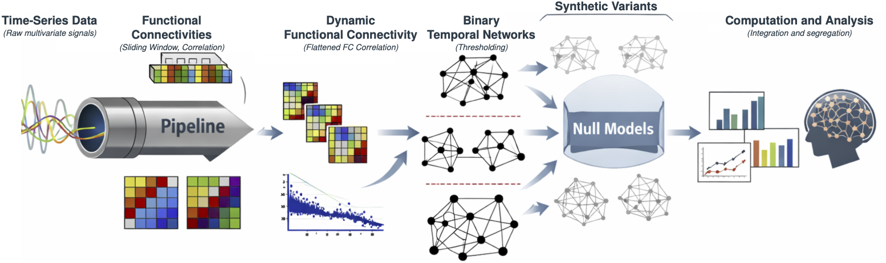

# Temporal Network Analysis Toolkit

 

This toolkit provides functions for building, transforming, and analyzing **temporal networks**.  
It is organized into five functional groups that form a **pipeline**:

## Installation

Version: 1.0.2. Requires Python 3.9 or newer.

From the source directory:

```sh
python -m pip install .
```

For an editable installation with parallel-processing and test dependencies:

```sh
python -m pip install -e ".[parallel,test]"
```

Core dependencies are NumPy, SciPy, scikit-learn and Numba. They are installed
automatically. `requirements.txt` lists the same core dependencies used by
the package metadata. The `parallel` extra adds Joblib and tqdm; the `test`
extra adds Joblib and NetworkX. NetworkX is not required by the toolkit's
modularity implementation.

The test suite has been checked with Python 3.9, NumPy 1.26.4, SciPy 1.13.1,
scikit-learn 1.6.1, Numba 0.60.0 and Joblib 1.5.2. These are tested versions,
not a requirement to pin every installation to that environment.

## Quick start

```python
import numpy as np
from tnet_analysis.latency_measures import SmartWalker, MeanLatencyMatrixAnalysis
from tnet_analysis.segregation_and_cohesion import ComputeSpatialClustering

rng = np.random.default_rng(42)
upper = np.triu(rng.binomial(1, 0.2, size=(20, 10, 10)), k=1)
network = upper + upper.transpose(0, 2, 1)  # (frames, nodes, nodes)

# Structure measures use zero diagonals.
clustering = ComputeSpatialClustering(network, summary_stat="both")

# Diagonal ones allow waiting at a node during temporal propagation.
walk_network = network.copy()
walk_network[:, np.arange(10), np.arange(10)] = 1
distances = SmartWalker(walk_network)  # One hop per frame by default.
metrics = MeanLatencyMatrixAnalysis(distances, penalty=21, summary_stat="both")
```

Temporal adjacency arrays have shape (frames, nodes, nodes); functional
connectivity input signals have shape (time points, nodes). Follow each
function's docstring for symmetry, weights and diagonal requirements.
Latency walkers and return latency accept `hops_per_frame`, defaulting to 1.
Temporal clustering uses `delta=1` by default. Retention uses unlimited
history by default (`delta=None`); a positive delta sets its lookback lifetime.
Numba compiles kernels on first use, so the first call can be slower than
subsequent calls. NaN values can indicate isolates or insufficient observations.

---

## 📂 Group 1: DFC → TNet
**Convert dynamic functional connectivity (DFC) into temporal networks.**

- `ComputeDynamicFunctionalConnectivity(time_series, window, lag)`  
  → Sliding-window Pearson correlation matrices.  
- `ComputeFunctionalConnectivity(time_series, window=20, lag=1, method="original1")`  
  → Pearson FC (`original1`) or pointwise z-score products (`original2`).  
- `PhaseRandSurrogates`, `PrepareConnectivity`, `PrepareTemporalNetwork`  
  → Signal surrogates and a common signal-to-network preparation pipeline.  
- `FindThresholdForAverageDegree(adj_tensor, target_degree, resolution=100)`  
  → Find threshold to match a target average degree.  
- `BinarizeDFC(time_series, target_degree, window, lag)`  
  → Pipeline: DFC → thresholding → binary adjacency.  
- `SetDiagonals(tensor, value=1)`  
  → Utility to enforce diagonal values.  

---

## 📂 Group 2: Temporal Network Generators
**Create synthetic and null temporal networks.**

- `GenerateSymmetricRandomNetwork`  
- `GenerateSymmetricSmallWorldNetwork`  
- `GenerateSymmetricScaleFreeNetwork`  
- `GenerateSymmetricNetwork` (dispatch by type)  
- `GenerateStaticTemporalNetwork`  
- `GenerateTemporalNetworkByLinkActivation`  
- `GenerateTemporalNetworkWithDensityVariation`  
- `GenerateTemporalLinkCounts`  
- `GenerateNullModel`  
- `PartiallyRandomizeMatrix`  
- `GenerateRandomizedTemporalNetwork`  
- `TrimIsolatedNodes`  

---

## 📂 Group 3: Distance & Return Metrics
**Temporal reachability, shortest paths, and return-to-source latency.**

- `ComputeAverageDegree`  
- `SmartWalker` → Earliest arrival latencies.  
- `RandomWalker` → Monte Carlo first-passage latencies.  
- `MeanLatencyMatrixAnalysis` → Summarize latency matrix.  
- `ComputeSmartTemporalDistanceMeasures` → Summarize earliest-arrival distances.  
- `ComputeDrunkTemporalDistanceMeasures` → Summarize Monte Carlo first-passage distances.  
- `ComputeReturnLatency`  

---

## 📂 Group 4: Temporal Dynamism & Memory
**Quantify network volatility and temporal memory.**

- `ComputeTemporalMutualInformation`  
- `ComputeDynamism` → Transition probability, entropy, similarity, fluidity, mutual information and edge-count change.  
- `ComputeTemporalEdgeOverlap`  
- `ComputeEdgePersistenceRate`  
- `ComputeNeighborhoodMemory`  
- `ComputeRetention` → Returning-neighbor fraction; `delta=None` keeps unlimited history, or supply a positive lookback lifetime in frames.  
- `ComputeLinkBurstiness`  

---

## 📂 Group 5: Segregation & Cohesion Structure
**Measure clustering, modularity, and persistence of community structure.**

- `ComputeSpatialClustering`  
- `ComputeTemporalClustering`  
- `ComputeSnapshotTransitivity`, `ComputeTemporalTransitivity`  
- `ComputeSnapshotParticipationCoefficient`, `ComputeTemporalParticipationCoefficient`  
- `ComputePartnerStability`  
- `ComputePartnerDiversity`  
- `ComputeNodePersistence`  


---

## 📂 Group 5.1: Modularity

- `SnapshotModularity` → Score supplied community labels.  
- `DetectCommunitiesLouvain` → Detect communities using the sparse implementation.  
- `ComputeSnapshotModularity`, `ComputeTemporalModularity`  

## 📌 Pipeline Overview

1. **Time series → TNet** (Group 1)  
2. **Null models & synthetic networks** (Group 2)  
3. **Distance & return metrics** (Group 3)  
4. **Dynamism & memory analysis** (Group 4)  
5. **Segregation & cohesion analysis** (Group 5)  

Together these provide a unified framework for studying both **integration** and **segregation** in temporal networks.

## Function names and aliases

| Function | Supported alias |
|---|---|
| `ComputeRetention` | `ComputeReturnability` |
| `ComputeReturnLatency` | `ComputeCirculationLatency` |
| `ComputeSpatialClustering` | `ComputeStaticClustering` |
| `ComputeLinkBurstiness` | `LinkBurstiness` |

Aliases refer to the same implementation and accept the same arguments.
The `smart_circulation` module also exposes `ComputeReturnLatency` and
`ComputeCirculationLatency` as imports of the optimized implementation in
`latency_measures`.

Return latency describes propagation back to its starting node; retention
describes recurrence of current neighbors within eligible past history.
`ComputeReturnLatency(return_full=True)` provides per-node hit counts and
latencies in addition to summary statistics. Return counts are counts of
successful returns, not a standalone return-rate estimate.

## Summary statistics and examples

Node-score measures accept `summary_stat=None` or `"percentiles"` for
the 5th, 25th, 50th, 75th and 95th percentiles, `"mean"` or `"median"`
for a scalar, and `"both"` for [mean, median]. Check each function's
docstring for its supported options and additional outputs.

`MeanLatencyMatrixAnalysis` returns five values by default:
impermeability, latency, resistance, inaccessibility and irrigation.
With `summary_stat="both"`, the first three measures each have mean and
median values, followed by the two counts, giving eight values.
`SnapshotModularity` scores a supplied partition; the individual structure
functions provide clustering, participation, diversity and persistence measures.

Example scripts are in `tnet_analysis/example`. Configure input files under
`data/input` relative to the working directory. The subject examples expect
a MATLAB file `time_series.mat` with key `tseries` and an array of shape
(subjects, time points, nodes). Subject index 5 is zero-based.
The example metric layout uses `spatial_clustering_mean/median`,
`return_latency_mean/median`, `return_mean_count` and
`retention_mean/median`. Output-name mappings distinguish actual values
from padding.

## User guide

Read the [online user guide](https://temporal-network-analysis-toolkit.readthedocs.io/en/latest/)
on Read the Docs, or download the [PDF for offline reading](output/pdf/tnet_analysis-1.0.2-user-guide.pdf).

The practical Sphinx guide is in [docs/index.rst](docs/index.rst). It covers
inputs, workflows, measures, parameters, result layouts and parallel computation,
with downloadable examples and an API reference.

To build the browsable guide from source:

```sh
python -m pip install ".[docs]"
python -m sphinx -W --keep-going -b html docs docs/_build/html
```

Open `docs/_build/html/index.html` in a browser.
For offline reading, download the [PDF user guide](output/pdf/tnet_analysis-1.0.2-user-guide.pdf).
The Sphinx guide also explains how to rebuild the PDF using XeLaTeX and latexmk.

### Publishing on Read the Docs

The repository includes `.readthedocs.yaml` to build the HTML guide with
Python 3.11 and the package's `docs` extra. Documentation warnings fail the
build. Read the Docs also produces a downloadable HTML archive; the guide's
PDF link uses the checked-in PDF, not a separately generated hosted PDF.
When the guide changes, rebuild the PDF as described in the guide and commit
the updated file before pushing.

After pushing:

1. Sign in to [Read the Docs Community](https://app.readthedocs.org/) with
   your GitHub account, and authorize its integration for this repository.
2. Add/import the repository as a documentation project and select the
   default branch. The first build should start automatically; check its
   status under **Builds**.
3. Open **View docs** after the build succeeds. Check the guide and its PDF
   download. The hosted guide is linked above and in the package's
   documentation metadata.
4. For a versioned release, push a Git tag such as `v1.0.2` that includes this
   configuration. Activate/build it under **Versions** and select the desired
   default version. Keep `latest` for the development branch and use a release
   version (or `stable`, when available) for release documentation.

The configuration assumes the package, `docs/` and `output/pdf/` are at the
Git repository root. If the package is instead inside a repository subfolder,
adjust both `sphinx.configuration` and `python.install.path` accordingly;
Read the Docs resolves paths from the repository root, even when its
configuration file is in a subfolder.

See the official [project setup instructions](https://docs.readthedocs.com/platform/stable/intro/add-project.html)
and [configuration reference](https://docs.readthedocs.com/platform/stable/config-file/v2.html).

## Tests

Run from the package root:

```sh
python -m pip install ".[test]"
python -m unittest discover -s tests -p 'test_*.py' -v
```

Tests cover independent reference calculations, boundary cases, input
immutability, alias identity and sequential/parallel example output agreement.
NetworkX is optional and used only for independent modularity test references.

## Building a release

```sh
python -m pip install ".[release]"
python -m build
python -m twine check dist/*
```

These commands build and check the source distribution and wheel; they do
not upload or publish either artifact.

## License

MIT. See [LICENSE](LICENSE).
